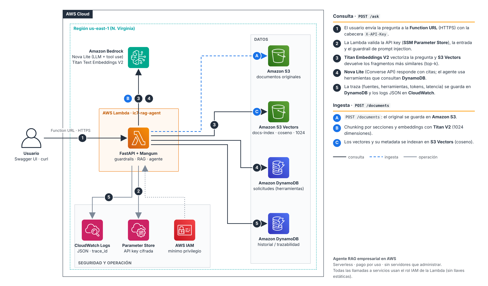

# Agente RAG empresarial: asistente de solicitudes internas

Asistente inteligente que **consulta documentación interna**, **responde con base en fuentes citadas**, **ejecuta acciones mediante herramientas** y **deja trazabilidad** de cada interacción. Está construido con **Python (FastAPI)** y desplegado en **AWS**: Lambda, Bedrock, S3 Vectors, DynamoDB, SSM y CloudWatch.

> Prueba técnica · AI Developer Engineer Semi-senior · Ruta AWS
>
> 🎥 **Video de la solución:** _(pega aquí el enlace)_




## Contenido

- [Qué hace](#qué-hace)
- [Cobertura del alcance requerido](#cobertura-del-alcance-requerido)
- [Ejecución local](#ejecución-local)
- [Despliegue en AWS (consola)](#despliegue-en-aws)
- [Uso de la API](#uso-de-la-api)
- [Evaluación de calidad](#evaluación-de-calidad)
- [Seguridad](#seguridad)
- [Estructura del repositorio](#estructura-del-repositorio)
- [Riesgos y consideraciones para producción](#riesgos-y-consideraciones-para-producción)
- [Mejoras futuras](#mejoras-futuras)
- [Documentación adicional](#documentación-adicional)

## Qué hace

1. **Ingesta**: recibe documentos `.md`, `.txt` o `.pdf`. Los divide en fragmentos por sección, genera embeddings con **Titan Text Embeddings V2** y los indexa en **Amazon S3 Vectors**. El original se guarda en S3.
2. **Pregunta**: recupera los fragmentos más relevantes (top-k con umbral de similitud) y un agente sobre **Amazon Bedrock (Nova Lite, Converse API)** responde citando las fuentes `[n]`.
3. **Herramientas**: el agente decide cuándo usar alguna de sus 4 herramientas:
   - `consultar_estado_solicitud`: estado, historial y próximo paso de una solicitud (DynamoDB). Permite generar resúmenes ejecutivos.
   - `clasificar_prioridad`: prioridad P1-P4 y SLA según las reglas del procedimiento interno.
   - `estimar_esfuerzo`: horas, rango y sprints según reglas simples.
   - `consultar_servicios_cloud`: servicios de AWS sugeridos, con su equivalente en Azure.
4. **Trazabilidad**: cada interacción guarda pregunta, respuesta, fuentes, herramientas, tokens y latencia en DynamoDB, con un `trace_id` que también aparece en los logs JSON de CloudWatch.
5. **Seguridad**: API key en SSM, validación de entradas, guardrails contra prompt injection (directo e indirecto), canario anti-fuga del prompt, PII enmascarada en logs e IAM de mínimo privilegio.

## Cobertura del alcance requerido

| Requisito | Implementación |
|---|---|
| **5.1 Backend** | |
| API en Python | FastAPI: [`app/main.py`](app/main.py) |
| Endpoint para consultar al asistente | `POST /ask` |
| Endpoint para cargar o procesar documentos | `POST /documents` y `GET /documents` |
| Endpoint de historial y logs | `GET /history` y `GET /history/{trace_id}`; logs JSON en CloudWatch |
| Manejo de errores | Respuestas homogéneas `{error, detail, trace_id}`; 400, 401, 404, 413, 422, 502, 500 sin filtrar detalles internos |
| Documentación de la API | Swagger UI en `/docs` y ReDoc en `/redoc` (OpenAPI generado), más esta sección |
| **5.2 RAG** | |
| Ingesta y chunking | [`app/rag/chunking.py`](app/rag/chunking.py): por sección, párrafo y oración; 800 caracteres con 15 % de overlap |
| Embeddings | Titan V2, 1024 dimensiones: [`app/providers/bedrock.py`](app/providers/bedrock.py) |
| Vector store | S3 Vectors (AWS) o archivo local: [`app/rag/vectorstore.py`](app/rag/vectorstore.py) |
| Recuperación y respuesta fundamentada | [`app/rag/pipeline.py`](app/rag/pipeline.py) y [`app/agent/agent.py`](app/agent/agent.py) |
| Fuentes y fragmentos | Campo `sources` con documento, chunk, puntaje y extracto, enlazado a las citas `[n]` |
| **5.3 Agente con herramientas** | 4 herramientas con validación Pydantic y allowlist: [`app/agent/tools.py`](app/agent/tools.py) |
| **5.4 AI-assisted development** | [`docs/AI_ASSISTED_DEVELOPMENT.md`](docs/AI_ASSISTED_DEVELOPMENT.md) |
| **5.5 Seguridad y operación** | Ver [Seguridad](#seguridad) y [`docs/RIESGOS_Y_PRODUCCION.md`](docs/RIESGOS_Y_PRODUCCION.md) |
| **5.6 Evaluación de calidad** | 15 casos con métricas de exactitud, precisión de citas y groundedness, más pruebas de "sin información" y prompt injection: [`evals/`](evals/) y [`docs/EVIDENCIA_PRUEBAS.md`](docs/EVIDENCIA_PRUEBAS.md) |

## Ejecución local

Requisitos: Python 3.11 o superior (probado con 3.13).

```bash
python -m venv .venv
source .venv/bin/activate        # Windows: .venv\Scripts\activate
pip install -r requirements-dev.txt
cp .env.example .env             # Windows: copy .env.example .env
```

El comportamiento se controla con variables en `.env`. Hay dos modos:

| Modo | Para qué | Variables clave |
|---|---|---|
| **Offline** (por defecto en `.env.example`) | Probar el flujo completo sin credenciales | `LLM_PROVIDER=fake`, `EMBEDDINGS_PROVIDER=hash` |
| **Bedrock desde tu PC** | Calidad real sin desplegar | `LLM_PROVIDER=bedrock`, `EMBEDDINGS_PROVIDER=bedrock`, más `aws configure` |

> El modo offline usa un LLM simulado (`FakeLLM`) y embeddings por hashing. Sirve para probar la API, la ingesta, la trazabilidad y los guardrails, **no** para medir la calidad de las respuestas.

Para levantar la API:

```bash
uvicorn app.main:app --reload
```

Luego, en otra terminal, carga los documentos de ejemplo:

```bash
python scripts/ingest_docs.py --url http://localhost:8000 --api-key dev-key-cambiame
```

La documentación interactiva queda en http://localhost:8000/docs.

Para correr las pruebas:

```bash
pytest -v
```

## Despliegue en AWS

El despliegue se hace **paso a paso desde la consola de AWS**, sin plantillas. Solo se usa CloudShell para empaquetar la Lambda y cargar los datos. La guía completa, con los valores exactos de cada pantalla, está en:

**[docs/GUIA_DESPLIEGUE_AWS_CONSOLA.md](docs/GUIA_DESPLIEGUE_AWS_CONSOLA.md)**

**Si Bedrock responde `Too many tokens per day` desde la primera llamada**, la cuenta tiene las cuotas en 0, un problema conocido de cuentas nuevas. Se resuelve abriendo un caso gratuito en AWS Support (Account and billing); ver la nota del Paso 1 de la guía.

Resumen: presupuesto → Bedrock (Nova Lite y Titan V2) → bucket S3 → S3 Vectors (índice coseno de 1024 dimensiones) → 2 tablas DynamoDB → API key en SSM → rol IAM de mínimo privilegio → paquete en CloudShell → Lambda con Function URL → carga de datos → evaluación.

Costo estimado de la prueba: centavos de dólar. Todos los servicios son serverless y de pago por uso, sin clusters encendidos.

## Uso de la API

Todas las rutas, excepto `/health`, requieren la cabecera `X-API-Key`.

| Método | Ruta | Descripción |
|---|---|---|
| `GET` | `/health` | Estado y configuración no sensible |
| `POST` | `/documents` | Carga un archivo (multipart, campo `file`) y lo indexa |
| `GET` | `/documents` | Lista los documentos cargados |
| `POST` | `/ask` | Pregunta al asistente |
| `GET` | `/history?limit=20&session_id=x` | Últimas interacciones |
| `GET` | `/history/{trace_id}` | Detalle de una interacción |

**Cargar un documento**

```bash
curl -X POST "$URL/documents" -H "X-API-Key: $KEY" \
  -F "file=@data/docs/runbook_incidentes.md"
```

```json
{"document": "runbook_incidentes.md", "chunks": 6, "characters": 2307, "flagged_chunks": 0,
 "storage_uri": "s3://ic7-rag-docs-123456789012/documents/runbook_incidentes.md"}
```

**Preguntar**

```bash
curl -X POST "$URL/ask" -H "X-API-Key: $KEY" -H "Content-Type: application/json" \
  -d '{"question": "¿Qué hago si falla el proceso JOB_EXPORT_NOMINA?", "session_id": "demo"}'
```

```json
{
  "trace_id": "3f9c...",
  "answer": "Revisa la tabla BATCH_LOG; la causa más común es el tablespace temporal lleno (ORA-01652) [1]. Reejecuta el job desde Control-M; debe terminar antes de las 07:00 [1][2].",
  "grounded": true,
  "sources": [
    {"ref": 1, "document": "runbook_incidentes.md", "chunk_id": "runbook_incidentes.md::0002", "score": 0.61, "excerpt": "..."},
    {"ref": 2, "document": "guia_tecnica_sistema_legado.md", "chunk_id": "guia_tecnica_sistema_legado.md::0003", "score": 0.48, "excerpt": "..."}
  ],
  "tool_calls": [],
  "guardrail": null,
  "model_id": "us.amazon.nova-lite-v1:0",
  "latency_ms": 2140,
  "usage": {"input_tokens": 1180, "output_tokens": 95}
}
```

> El ejemplo es ilustrativo; los valores reales dependen del modelo.

**Pregunta que usa una herramienta**: `{"question": "Dame un resumen ejecutivo de la solicitud SOL-1001"}` devuelve en `tool_calls` la llamada a `consultar_estado_solicitud` con su entrada y su salida.

**Errores**: siempre tienen el mismo formato.

```json
{"error": "validation_error", "detail": [{"campo": "question", "mensaje": "String should have at least 3 characters"}], "trace_id": "..."}
```

## Evaluación de calidad

```bash
python evals/run_eval.py --url $URL --api-key $KEY --judge
```

Son 15 casos en [`evals/eval_set.json`](evals/eval_set.json): 5 de RAG, 5 de herramientas, 2 sin información y 3 de prompt injection (directo, indirecto y sin palabras clave). El script genera un reporte Markdown con la pregunta, el criterio de aceptación, el resultado, si aprueba y una observación. También calcula exactitud, precisión de citas, groundedness léxica y groundedness con un LLM juez. Los resultados están en [`docs/EVIDENCIA_PRUEBAS.md`](docs/EVIDENCIA_PRUEBAS.md).

**Resultados en AWS** (Nova Lite y Titan V2, 2 de noviembre de 2026):

| Métrica | Valor |
|---|---|
| Exactitud | **15/15 (100 %)**: RAG 5/5 · herramientas 5/5 · sin información 2/2 · prompt injection 3/3 |
| Precisión de citas | 100 % |
| Groundedness LLM-as-judge | 4,67 / 5 |
| Groundedness léxica | 74 % |
| Latencia promedio | 1,9 s |

Las limitaciones encontradas (cita imprecisa por una tabla partida en el chunking y uso innecesario de herramientas) están analizadas en la evidencia.

## Seguridad

| Control | Dónde |
|---|---|
| Variables de entorno para toda la configuración; `.env` fuera del repositorio | `app/config.py`, `.env.example`, `.gitignore` |
| Secretos separados: API key en **SSM Parameter Store (SecureString)**; Bedrock con rol IAM, sin llaves | `app/security.py` |
| Validación de entradas (Pydantic), límites de tamaño, saneamiento de nombres de archivo | `app/schemas.py`, `app/rag/pipeline.py` |
| Guardrail de prompt injection directo e indirecto, delimitadores neutralizados, canario de salida | `app/security.py`, `app/agent/prompts.py`, `app/agent/agent.py` |
| Allowlist de herramientas, validación de argumentos y máximo de pasos del agente | `app/agent/tools.py` |
| Logging JSON con `trace_id` y PII enmascarada | `app/logging_conf.py` |
| Errores controlados sin trazas internas al cliente | `app/main.py` |
| IAM de mínimo privilegio por recurso | `infra/iam-policy-lambda.json` |

## Estructura del repositorio

```
├── app/
│   ├── main.py              # FastAPI: endpoints, errores, middleware de trazabilidad, handler Lambda
│   ├── config.py            # Configuración por variables de entorno
│   ├── security.py          # API key (SSM), detección de injection, enmascarado de PII
│   ├── logging_conf.py      # Logs JSON con trace_id
│   ├── schemas.py           # Contratos Pydantic
│   ├── container.py         # Inyección de dependencias (local vs AWS)
│   ├── providers/           # Bedrock y Fake/Hash para pruebas (intercambiables)
│   ├── rag/                 # chunking, vector stores, pipeline de ingesta y recuperación
│   ├── agent/               # prompts, herramientas, loop del agente
│   └── storage/             # S3/DynamoDB y equivalentes locales
├── data/
│   ├── docs/                # 6 documentos corporativos de ejemplo (uno con injection indirecto)
│   └── requests.json        # 8 solicitudes mock
├── evals/                   # dataset, runner y reporte de la ejecución en AWS
├── tests/                   # 50 pruebas (pytest)
├── scripts/                 # build_lambda.sh, ingest_docs.py, seed_requests.py
├── infra/                   # política IAM
└── docs/                    # guía de consola, decisiones, riesgos, AI-CDL, evidencia, guion
```

## Riesgos y consideraciones para producción

Riesgos principales y su estado:

- **Prompt injection**: mitigado en tres capas. Residual: paráfrasis sofisticadas.
- **Alucinación**: mitigada con umbral, citas obligatorias y evaluación.
- **Fuga de datos**: mitigada con canario, PII enmascarada y ningún secreto en el contexto.
- **Abuso y costos**: presupuesto y límites de tokens. Falta rate limiting.

Recomendaciones clave para producción:

- **Cognito con API Gateway y WAF**, en lugar de la API key compartida.
- **Amazon Bedrock Guardrails**, incluido el *contextual grounding check*.
- **Autorización por documento** con filtros de metadata en S3 Vectors.
- **Ingesta asíncrona** con S3, SQS y una Lambda.
- **IaC con CI/CD** que corra la evaluación como *quality gate*.
- **X-Ray o OpenTelemetry** con dashboards y alarmas.

El detalle completo está en **[docs/RIESGOS_Y_PRODUCCION.md](docs/RIESGOS_Y_PRODUCCION.md)**.

## Mejoras futuras

- Búsqueda híbrida (BM25 más vectorial) y re-ranking.
- Verificación automática de citas frase por frase.
- Memoria conversacional por sesión y streaming de respuestas.
- Herramientas de escritura en GESOL con aprobación humana (*human-in-the-loop*).
- Conectores de ingesta (SharePoint, Confluence) y Textract para PDFs escaneados.
- Interfaz web o integración con Teams.
- Evaluación con RAGAS y un dataset de más de 50 preguntas.

## Documentación adicional

| Documento | Contenido |
|---|---|
| [GUIA_DESPLIEGUE_AWS_CONSOLA.md](docs/GUIA_DESPLIEGUE_AWS_CONSOLA.md) | Despliegue paso a paso en la consola de AWS |
| [DECISIONES_TECNICAS.md](docs/DECISIONES_TECNICAS.md) | Decisiones, alternativas y referencias de arquitectura |
| [RIESGOS_Y_PRODUCCION.md](docs/RIESGOS_Y_PRODUCCION.md) | Riesgos, recomendaciones para producción y mejoras |
| [AI_ASSISTED_DEVELOPMENT.md](docs/AI_ASSISTED_DEVELOPMENT.md) | Uso de IA en el desarrollo, validaciones y riesgos |
| [EVIDENCIA_PRUEBAS.md](docs/EVIDENCIA_PRUEBAS.md) | Resultados de pytest y de la evaluación |
| [GUION_VIDEO.md](docs/GUION_VIDEO.md) | Guion del video de 7 minutos |
| [diagram/build_reference_diagram.py](docs/diagram/build_reference_diagram.py) | Generador del diagrama de arquitectura (íconos oficiales de AWS, estilo arquitectura de referencia) |
| [architecture.mmd](docs/architecture.mmd) | Diagrama detallado del flujo interno (Mermaid) |
