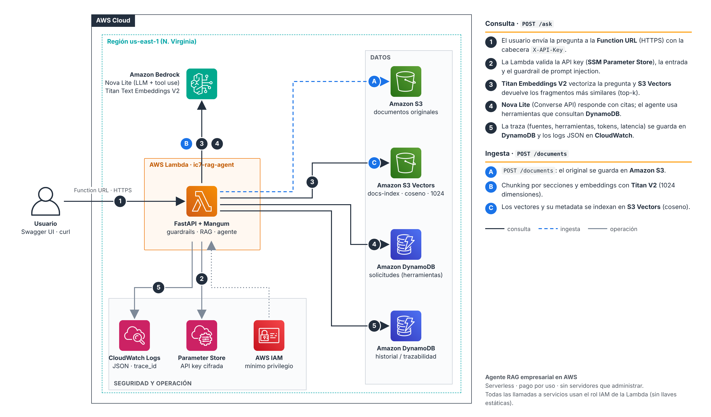

# Guía de despliegue en AWS paso a paso (consola)

Esta guía crea toda la solución **a mano desde la consola de AWS**, con clics y sin plantillas de infraestructura. El paquete de la Lambda (`lambda.zip`) ya viene armado; solo lo subes. La única parte que usa una terminal es la evaluación automática del Paso 12, que se corre en **AWS CloudShell** (la terminal gratuita integrada en la consola) con unos pocos comandos.



Tiempo estimado: 60 a 90 minutos la primera vez. Costo estimado: centavos de dólar, que salen de tus créditos.

> Los nombres de los botones pueden variar un poco según la versión de la consola. Si no encuentras uno exactamente igual, busca el equivalente en la misma pantalla.

## Recursos que vas a crear

| # | Servicio | Nombre | Para qué |
|---|---|---|---|
| 1 | AWS Budgets | `ic7-rag-budget` | Alerta de costos |
| 2 | Amazon Bedrock | Nova Lite y Titan Text Embeddings V2 | LLM y embeddings |
| 3 | Amazon S3 | `ic7-rag-docs-<ACCOUNT_ID>` | Documentos originales y paquete de la Lambda |
| 4 | Amazon S3 Vectors | `ic7-rag-vectors-<ACCOUNT_ID>` con el índice `docs-index` | Vector store |
| 5 | DynamoDB | `ic7-rag-history` | Historial y trazabilidad |
| 6 | DynamoDB | `ic7-rag-requests` | Solicitudes mock para las herramientas |
| 7 | SSM Parameter Store | `/ic7-rag/api-key` | API key (secreto) |
| 8 | IAM | `ic7-rag-lambda-role` | Permisos mínimos de la Lambda |
| 9 | AWS Lambda | `ic7-rag-agent` y su Function URL | API FastAPI |
| 10 | CloudWatch Logs | `/aws/lambda/ic7-rag-agent` | Logs estructurados |

En toda la guía, reemplaza `<ACCOUNT_ID>` por tu número de cuenta de 12 dígitos. Lo ves en el menú de tu usuario, arriba a la derecha de la consola.

---

## Paso 0. Región y alerta de presupuesto

1. Arriba a la derecha, selecciona la región **US East (N. Virginia) us-east-1**. Usa esta región en todos los pasos.
2. Busca **Budgets** en la barra de búsqueda y haz clic en **Create budget**.
3. Elige **Use a template (simplified)** y la plantilla **Monthly cost budget**.
4. Llena los campos:
   - Nombre: `ic7-rag-budget`
   - Monto: `5` USD
   - Tu correo electrónico
5. Haz clic en **Create budget**.

## Paso 1. Verificar los modelos de Bedrock

1. Abre **Amazon Bedrock** y entra a **Model catalog**.
2. Busca **Nova Lite** y abre la ficha del modelo. Haz clic en **Open in playground** y envía un "hola" en el chat.
   - Si responde, el modelo está listo.
   - Anota el **ID del modelo o del inference profile** que aparece en la ficha. Normalmente es `us.amazon.nova-lite-v1:0`.
3. Busca **Titan Text Embeddings V2**. Su ID es `amazon.titan-embed-text-v2:0`.
4. Si tu consola todavía muestra la página **Model access**, solicita acceso a esos dos modelos. Los de Amazon se aprueban al instante.

> **Si el playground responde `ThrottlingException: Too many tokens per day`**, las cuotas de tu cuenta están en 0 (problema conocido de cuentas nuevas):
> 1. Confírmalo en **Service Quotas → Amazon Bedrock**, buscando `Nova Lite`. El valor aplicado de "Model invocation max tokens per day" aparece en 0.
> 2. Abre un caso en **Support Center → Create case → Account and billing**, explicando que la cuenta está en el plan pagado y que las cuotas por modelo están en 0, y pide que apliquen los valores por defecto. Es gratis.
> 3. Mientras responden, puedes crear toda la infraestructura (Pasos 2 a 11) con `LLM_PROVIDER=fake`, `EMBEDDINGS_PROVIDER=hash` y `MIN_RELEVANCE=0.10`, y cambiar a Bedrock cuando se habilite (luego vuelve a cargar los documentos).
>
> Cuando se habilite, verifica en Service Quotas que los valores de Nova Lite y Titan Text Embeddings V2 ya no estén en 0.

## Paso 2. Bucket S3 para documentos

1. Abre **S3** y entra a **General purpose buckets**. Haz clic en **Create bucket**.
2. Llena los campos:
   - Bucket name: `ic7-rag-docs-<ACCOUNT_ID>`
   - Object Ownership: **ACLs disabled**
   - **Block all public access**: déjalo activado
   - Bucket Versioning: **Enable** (opcional; protege contra borrados accidentales)
   - Default encryption: **SSE-S3**
3. Haz clic en **Create bucket**.

## Paso 3. Vector store con S3 Vectors

1. En el menú izquierdo de S3, entra a **Vector buckets** y haz clic en **Create vector bucket**.
2. Llena los campos:
   - Name: `ic7-rag-vectors-<ACCOUNT_ID>`
   - Encryption: la que viene por defecto (SSE-S3)
3. Haz clic en **Create vector bucket**.
4. Abre el vector bucket y haz clic en **Create vector index**.
5. Llena los campos:
   - Index name: `docs-index`
   - Dimension: `1024`. Debe coincidir con `EMBEDDINGS_DIMENSION`.
   - Distance metric: **Cosine**
   - En **Non-filterable metadata**, agrega dos claves: `text` y `section`.
6. Haz clic en **Create vector index**.

> **Importante:** la dimensión, la métrica y las claves no filtrables **no se pueden cambiar después**. Si te equivocas, borra el índice y créalo de nuevo. Las claves `text` y `section` van como no filtrables porque el texto de cada fragmento supera el límite de 2 KB de la metadata filtrable.

## Paso 4. Tablas DynamoDB

**Tabla de historial**

1. Abre **DynamoDB**, entra a **Tables** y haz clic en **Create table**.
2. Llena los campos:
   - Table name: `ic7-rag-history`
   - Partition key: `pk`, tipo **String**
   - Sort key: `sk`, tipo **String**
3. En Table settings, elige **Customize settings** y luego Capacity mode **On-demand**.
4. Haz clic en **Create table**.

**Tabla de solicitudes**

1. Haz clic de nuevo en **Create table**.
2. Llena los campos:
   - Table name: `ic7-rag-requests`
   - Partition key: `request_id`, tipo **String**
   - Sin sort key
3. Elige **On-demand** y haz clic en **Create table**.

> Si prefieres quedarte en la capa gratuita permanente de DynamoDB, elige **Provisioned** con 1 RCU y 1 WCU y desactiva el auto scaling. Con On-demand el costo de esta prueba son fracciones de centavo.

## Paso 5. API key como secreto en SSM

1. Inventa una clave larga y aleatoria, de al menos 32 caracteres con letras y números. Puedes usar el generador de contraseñas de tu navegador o de tu gestor de contraseñas. Guárdala en un lugar seguro: la vas a usar para probar la API.
2. Abre **Systems Manager**, entra a **Parameter Store** y haz clic en **Create parameter**.
3. Llena los campos:
   - Name: `/ic7-rag/api-key`
   - Tier: **Standard**, que es gratis
   - Type: **SecureString**
   - KMS key source: **My current account**, con `alias/aws/ssm`
   - Value: la clave que generaste
4. Haz clic en **Create parameter**.

> La key nunca queda en el código ni en las variables de la Lambda. La Lambda la lee al ejecutarse con `ssm:GetParameter`, y el permiso está restringido a este parámetro.

## Paso 6. Rol IAM con mínimo privilegio

1. Abre **IAM**, entra a **Roles** y haz clic en **Create role**.
2. En Trusted entity type elige **AWS service**, en Use case elige **Lambda** y haz clic en **Next**.
3. Busca y marca **AWSLambdaBasicExecutionRole**, que permite escribir logs en CloudWatch. Haz clic en **Next**.
4. Escribe el nombre `ic7-rag-lambda-role` y haz clic en **Create role**.
5. Abre el rol y elige **Add permissions** → **Create inline policy** → pestaña **JSON**.
6. Pega el contenido de [`infra/iam-policy-lambda.json`](../infra/iam-policy-lambda.json) **reemplazando todas las apariciones de `ACCOUNT_ID`** por tu número de cuenta.
7. Haz clic en **Next**, escribe el nombre `ic7-rag-lambda-policy` y haz clic en **Create policy**.

Qué permite la política, y nada más:

| Permiso | Recurso |
|---|---|
| `bedrock:InvokeModel` | Solo Nova Lite y Titan Embeddings V2 |
| `s3:PutObject`, `s3:GetObject`, `s3:ListBucket` | Solo el prefijo `documents/` del bucket |
| `s3vectors:PutVectors`, `QueryVectors`, `GetVectors`, `ListVectors`, `DeleteVectors` | Solo el índice `docs-index` |
| `dynamodb:PutItem`, `GetItem`, `Query` | Solo las dos tablas |
| `ssm:GetParameter` | Solo `/ic7-rag/api-key` |

> Si en el Paso 1 tu modelo tenía otro ID (por ejemplo una versión más nueva de Nova), actualiza los ARN de la política y la variable `LLM_MODEL_ID`.

## Paso 7. Subir el paquete de la Lambda a S3

El archivo `lambda.zip` ya viene armado: contiene el código y sus librerías compiladas para Linux x86_64 y Python 3.13.

1. Abre **S3** y entra al bucket `ic7-rag-docs-<ACCOUNT_ID>`.
2. Haz clic en **Create folder**, escribe `deploy` y haz clic en **Create folder**.
3. Entra a `deploy/`, haz clic en **Upload** → **Add files**, elige `lambda.zip` y haz clic en **Upload**.
4. Haz clic sobre el archivo subido y copia su **S3 URI**: `s3://ic7-rag-docs-<ACCOUNT_ID>/deploy/lambda.zip`.

> **Si cambias el código** tienes que volver a armar el paquete en Linux. Ver el Paso 13; no lo armes en Windows ni en una Mac con chip M, porque la Lambda falla con `Unable to import module`.

## Paso 8. Crear la función Lambda

1. Abre **Lambda** y haz clic en **Create function** → **Author from scratch**.
2. Llena los campos:
   - Function name: `ic7-rag-agent`
   - Runtime: **Python 3.13**
   - Architecture: **x86_64**
   - En Change default execution role, elige **Use an existing role** → `ic7-rag-lambda-role`
3. Haz clic en **Create function**.

**Subir el código**

En la pestaña **Code**, elige **Upload from** → **Amazon S3 location**, pega `s3://ic7-rag-docs-<ACCOUNT_ID>/deploy/lambda.zip` y haz clic en **Save**.

**Handler**

En la misma pestaña Code, baja a **Runtime settings** y haz clic en **Edit**. Escribe el handler `app.main.handler` y haz clic en **Save**.

**Memoria y timeout**

Ve a **Configuration** → **General configuration** → **Edit** y pon:
- Memory: `1024` MB
- Timeout: `1 min 0 sec`

Haz clic en **Save**.

**Variables de entorno**

Ve a **Configuration** → **Environment variables** → **Edit** y agrega cada una:

| Key | Value |
|---|---|
| `APP_ENV` | `aws` |
| `LLM_PROVIDER` | `bedrock` |
| `EMBEDDINGS_PROVIDER` | `bedrock` |
| `VECTOR_STORE` | `s3vectors` |
| `STORAGE_BACKEND` | `aws` |
| `LLM_MODEL_ID` | `us.amazon.nova-lite-v1:0` |
| `EMBEDDINGS_MODEL_ID` | `amazon.titan-embed-text-v2:0` |
| `EMBEDDINGS_DIMENSION` | `1024` |
| `DOCS_BUCKET` | `ic7-rag-docs-<ACCOUNT_ID>` |
| `VECTOR_BUCKET` | `ic7-rag-vectors-<ACCOUNT_ID>` |
| `VECTOR_INDEX` | `docs-index` |
| `HISTORY_TABLE` | `ic7-rag-history` |
| `REQUESTS_TABLE` | `ic7-rag-requests` |
| `API_KEY_SSM_PARAM` | `/ic7-rag/api-key` |
| `MIN_RELEVANCE` | `0.20` |
| `LOG_LEVEL` | `INFO` |

> No agregues `AWS_REGION`: Lambda la define automáticamente. Ninguna de estas variables es un secreto.

**Function URL**

1. Ve a **Configuration** → **Function URL** → **Create function URL**.
2. Elige Auth type **NONE**. La API se protege con la cabecera `X-API-Key`; en producción se usaría `AWS_IAM` o API Gateway con Cognito (ver RIESGOS_Y_PRODUCCION.md).
3. Haz clic en **Save** y copia la URL, que tiene la forma `https://xxxx.lambda-url.us-east-1.on.aws/`.

## Paso 9. Cargar las solicitudes mock y los documentos

**Probar que la API responde**

Abre en el navegador `https://xxxx.lambda-url.us-east-1.on.aws/health`. Debe responder `{"status":"ok", ...}`.

**Solicitudes en DynamoDB**

1. Abre **DynamoDB**, entra a **Explore items** y selecciona `ic7-rag-requests`.
2. Haz clic en **Create item** y luego en **JSON view**. Desactiva **View DynamoDB JSON** para pegar JSON normal.
3. Abre `data/requests.json` del repositorio, copia una solicitud completa (desde `{` hasta su `}`) y pégala reemplazando el contenido del editor.
4. Haz clic en **Create item**.
5. Repite con las demás. Como mínimo carga **SOL-1001, SOL-1003 y SOL-1004**, que son las que usan la evaluación y el video.

**Documentos desde Swagger**

1. Abre `https://xxxx.lambda-url.us-east-1.on.aws/docs`.
2. Haz clic en **Authorize**, pega tu API key, haz clic en **Authorize** y luego en **Close**.
3. Abre **POST /documents**, haz clic en **Try it out**, elige un archivo de `data/docs/` y haz clic en **Execute**.
4. Debe responder **201** con el número de chunks.
5. Repite con los 6 documentos. El boletín del proveedor debe mostrar `flagged_chunks: 1`: es el documento con injection indirecto.

Para verificar en la consola:
- **S3**: el bucket debe tener `documents/` con los 6 archivos.
- **S3 Vectors**: el índice `docs-index` debe tener vectores.
- **DynamoDB**: en Explore items de `ic7-rag-requests` deben aparecer las solicitudes que cargaste.

## Paso 10. Probar la API

**Desde el navegador (para el video)**

1. Abre `https://xxxx.lambda-url.us-east-1.on.aws/docs` para ver Swagger UI.
2. Haz clic en **Authorize**, pega la key y vuelve a hacer clic en **Authorize**.
3. Prueba `POST /ask` con este cuerpo:
   ```json
   {"question": "¿Cuál es el tiempo de resolución de una solicitud P2?", "session_id": "demo"}
   ```
4. Prueba `GET /history`.

**Desde una terminal (opcional)**

Primero define `URL` y `KEY` con tus valores (`export URL=...` y `export KEY=...`).

```bash
curl -s -X POST $URL/ask -H "X-API-Key: $KEY" -H "Content-Type: application/json" \
  -d '{"question":"Dame un resumen ejecutivo de la solicitud SOL-1001"}' | python3 -m json.tool

curl -s "$URL/history?limit=5" -H "X-API-Key: $KEY" | python3 -m json.tool
```

## Paso 11. Logs y trazabilidad en CloudWatch

1. En la Lambda, ve a **Monitor** → **View CloudWatch logs** para ver un log JSON por evento, cada uno con su `trace_id`.
2. Entra a **CloudWatch** → **Logs Insights**, selecciona el grupo `/aws/lambda/ic7-rag-agent` y ejecuta:
   ```
   fields @timestamp, trace_id, latency_ms, grounded, guardrail, tools, sources
   | filter msg = "ask_completed"
   | sort @timestamp desc
   | limit 50
   ```
3. Para ver los intentos de prompt injection:
   ```
   fields @timestamp, trace_id, categories, msg
   | filter msg in ["prompt_injection_blocked", "chunk_flagged", "system_prompt_leak_blocked"]
   ```
4. Para seguir una interacción completa, busca su trace_id con `filter trace_id = "<trace_id>"`. Verás la petición HTTP, la recuperación con sus puntajes, las herramientas y la respuesta.
5. Opcionalmente, crea una alarma:
   - En el log group, entra a **Metric filters** y crea un filtro con el patrón `{ $.msg = "prompt_injection_blocked" }`.
   - Luego crea una **Alarm** sobre esa métrica que avise si hay más de 5 intentos en 5 minutos.

## Paso 12. Correr la evaluación

Es la única parte que usa una terminal.

1. Abre **CloudShell** con el ícono `>_` de la barra superior y espera a que cargue.
2. Haz clic en **Actions** → **Upload file** y sube `rag-agent.zip`.
3. Ejecuta, reemplazando la URL por la tuya:
   ```bash
   unzip -q rag-agent.zip -d ~ && cd ~/rag-agent
   export URL="https://xxxx.lambda-url.us-east-1.on.aws"   # sin "/" al final
   export KEY=$(aws ssm get-parameter --name /ic7-rag/api-key --with-decryption --query Parameter.Value --output text)
   pip3 install --user boto3 --quiet
   python3 evals/run_eval.py --url $URL --api-key $KEY --judge
   ```
4. El script imprime PASS o FAIL por pregunta y genera `evals/results/report-<fecha>.md`.
5. Descárgalo con **Actions** → **Download file**, escribiendo la ruta `rag-agent/evals/results/report-<fecha>.md`. Ese archivo es la **evidencia de pruebas** del entregable.

> **Alternativa sin terminal:** haz las 15 preguntas de `evals/eval_set.json` en Swagger (POST /ask) y llena tú la tabla de `docs/EVIDENCIA_PRUEBAS.md`. Es más lento y no calcula las métricas automáticamente.

> Revisa los puntajes de recuperación en los logs (evento `retrieval`). Si preguntas válidas responden "no encontré información", baja `MIN_RELEVANCE` (por ejemplo a 0.15). Si responde con fragmentos irrelevantes, súbelo.

## Paso 13. Actualizar el código

Solo hace falta si modificas el código. El paquete se debe armar en Linux, y CloudShell sirve para eso. Con el repositorio ya descomprimido en CloudShell (Paso 12):

```bash
cd ~/rag-agent && bash scripts/build_lambda.sh
aws s3 cp build/lambda.zip s3://ic7-rag-docs-<ACCOUNT_ID>/deploy/lambda.zip
aws lambda update-function-code --function-name ic7-rag-agent \
  --s3-bucket ic7-rag-docs-<ACCOUNT_ID> --s3-key deploy/lambda.zip
```

Las dos primeras líneas arman y suben el paquete. Si prefieres, después de esas dos haz la actualización desde la consola con **Code** → **Upload from** → **Amazon S3 location**, en lugar de la tercera.

## Paso 14. Preparar la entrega

**1. Pegar la evidencia de la evaluación**

Abre el `report-<fecha>.md` del Paso 12 y copia su contenido en `docs/EVIDENCIA_PRUEBAS.md`, en la sección **Resultados obtenidos**, reemplazando la tabla de ejemplo. Agrega tus observaciones: qué falló, qué ajustaste y cómo quedó.

**2. Personalizar el documento de IA**

Revisa `docs/AI_ASSISTED_DEVELOPMENT.md` y ajústalo a lo que tú hiciste, validaste y aprendiste.

**3. Subir el repositorio a GitHub (sin comandos)**

1. En https://github.com/new crea un repositorio, por ejemplo `agente-rag-aws`. Puede ser **Public**, o **Private** si después invitas al evaluador. **No** marques "Add a README".
2. En la página del repositorio vacío, haz clic en **uploading an existing file**.
3. Descomprime `rag-agent.zip` en tu PC, entra a la carpeta `rag-agent` y **arrastra todo su contenido**: las carpetas `app`, `data`, `docs`, `evals`, `infra`, `scripts` y `tests`, y los archivos `README.md`, `requirements*.txt`, `.env.example` y `.gitignore`.
4. Escribe un mensaje como `Entrega prueba técnica: agente RAG en AWS` y haz clic en **Commit changes**.
5. Abre el repositorio y verifica que el README se vea con el diagrama.

> **No subas** `lambda.zip`, ningún archivo `.env` ni capturas donde se vea tu API key o tu número de cuenta completo.

**4. Grabar el video** (máximo 7 minutos), siguiendo `docs/GUION_VIDEO.md`. Súbelo a YouTube como "No listado", a Google Drive o a Loom, y agrega el enlace al README.

**5. Lista de verificación final**

| Entregable | Dónde |
|---|---|
| Repositorio de código | Enlace de GitHub |
| README con instalación y ejecución | `README.md` |
| Diagrama de arquitectura | `docs/architecture_aws.png` |
| Documento de decisiones técnicas | `docs/DECISIONES_TECNICAS.md` |
| Evidencia de pruebas | `docs/EVIDENCIA_PRUEBAS.md`, con el reporte de evaluación pegado |
| Video de máximo 7 minutos | Enlace en el README |
| Mejoras futuras | README y `docs/RIESGOS_Y_PRODUCCION.md` |
| Riesgos y consideraciones para producción | `docs/RIESGOS_Y_PRODUCCION.md` |
| Desarrollo asistido por IA | `docs/AI_ASSISTED_DEVELOPMENT.md` |

**6. Después de entregar**, puedes dejar la Lambda activa: sin uso no cobra. **Cambia la API key** en SSM si alguna vez la compartiste o se vio en una captura.

## Solución de problemas

| Síntoma | Causa probable | Solución |
|---|---|---|
| `Runtime.ImportModuleError: Unable to import module 'app.main'` | Handler mal escrito o paquete armado en Windows/Mac | Handler `app.main.handler`; empaquetar en CloudShell |
| `502 model_provider_error` | Bedrock rechazó la llamada | Revisa el log: `AccessDeniedException` es IAM o acceso al modelo; `ValidationException ... on-demand throughput` significa que hay que usar el ID con prefijo `us.` |
| `AccessDeniedException` en `QueryVectors` | Falta `s3vectors:GetVectors` (se requiere para devolver metadata) | Revisa la política del Paso 6 |
| `ValidationException` de dimensión | El índice no es de 1024 o cambiaste `EMBEDDINGS_DIMENSION` | Recrea el índice con la misma dimensión |
| `Task timed out after 3.00 seconds` | No cambiaste el timeout | Configuration → General → 1 minuto |
| `401 API key inválida` | Falta la cabecera `X-API-Key` | Botón Authorize en `/docs` o `-H "X-API-Key: ..."` |
| `500 API key no configurada` | Falta `API_KEY_SSM_PARAM` o el permiso SSM | Revisa las variables y la política |
| La primera petición tarda 3 a 5 s | Cold start de Lambda | Es normal; las siguientes son más rápidas |
| `ThrottlingException: Too many tokens per day` | Cuotas de Bedrock en 0 (cuenta nueva) | Ver la nota del Paso 1: caso en AWS Support |

## Limpieza (al terminar el proceso)

Borra los recursos en este orden:

1. La Function URL y la Lambda.
2. Las dos tablas DynamoDB.
3. El índice y el vector bucket.
4. El bucket S3 (primero vacíalo).
5. El parámetro SSM.
6. El rol IAM.
7. El log group de CloudWatch.

El presupuesto puede quedarse; es gratis.
